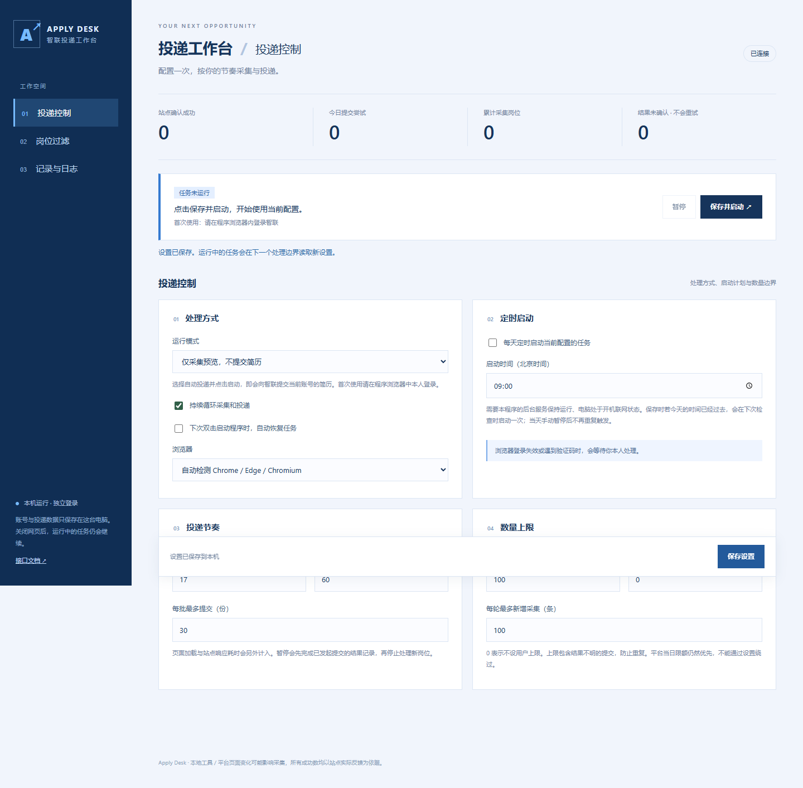
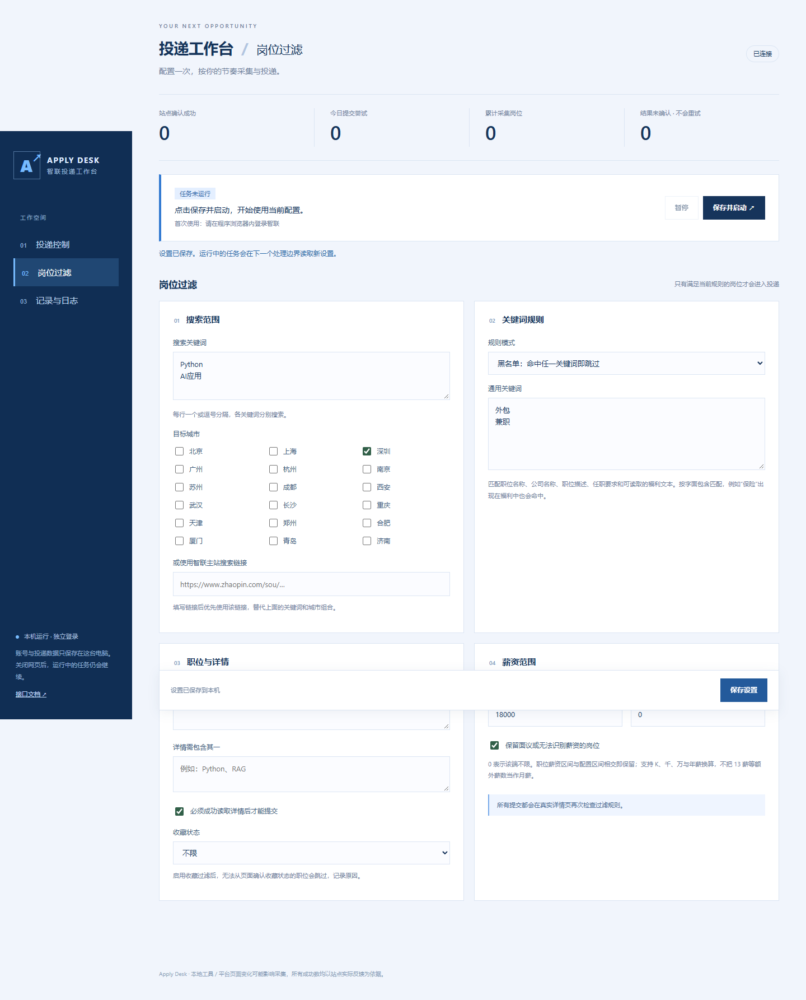
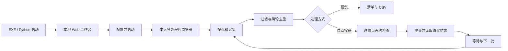

# Zhilian Apply Desk · 智联投递工作台

本地运行的智联招聘采集与投递工具：浏览器负责登录和操作，Web 工作台负责搜索、过滤、节奏、数量上限、暂停恢复、定时启动与记录导出。

**首次启动默认仅采集预览，不提交简历。** 在工作台明确选择“自动投递”并点击启动后，才会提交当前智联账号的简历。账号、Cookies、浏览器资料和投递记录保存在使用者自己的电脑，不随源码或发布包共享。

基于 [mengfei0001/AutoApplyZhiLian](https://github.com/mengfei0001/AutoApplyZhiLian) 改造，来源与许可见 [NOTICE.md](NOTICE.md)。





## 1. 选择启动方式

### 方式 A：Windows 便携版，不需要 Python

1. 打开本仓库的 [Releases](https://github.com/MarcusDog/ZhilianApplyDesk/releases)。
2. 下载 `ZhilianApplyDesk-Windows-x64.zip`。
3. **先完整解压**到一个可写目录，例如“文档”下。不要在压缩包中直接双击，也不要只取出 EXE。
4. 保留 EXE 旁的 `_internal` 文件夹，它包含网页、Python 运行时和 Playwright 驱动。
5. 双击 `ZhilianApplyDesk.exe`，默认浏览器会打开 <http://127.0.0.1:8765>。
6. 安装 Google Chrome 或 Microsoft Edge，或在源码方式中安装 Playwright Chromium；程序会按配置自动检测浏览器。

需要桌面入口时，右键这个 EXE →“显示更多选项”→“发送到”→“桌面快捷方式”。以后每天双击快捷方式即可。

便携版面向 **Windows 10/11 x64**。源码可在 Python 3.11+ 环境使用；Linux 还需要图形显示环境和浏览器依赖。自动化 CI 覆盖 Windows/Linux 的核心逻辑，但不代表所有操作系统上的智联页面流程都已实机验证。

### 方式 B：Git 克隆后使用 uv

前置条件：Git、[uv](https://docs.astral.sh/uv/)、Chrome/Edge，或 Playwright Chromium。

```powershell
git clone https://github.com/MarcusDog/ZhilianApplyDesk.git
cd ZhilianApplyDesk
uv sync --locked
uv run python desktop_entry.py
```

也可以在 Windows 双击仓库中的 `启动工作台.cmd`。首次会同步依赖，随后打开本地页面。命令行出错时窗口会保留错误。

如果没有安装 Chrome/Edge：

```powershell
uv run playwright install chromium
```

Linux 安装浏览器及系统依赖：

```bash
uv run playwright install --with-deps chromium
```

### 方式 C：普通 Python / venv

```powershell
git clone https://github.com/MarcusDog/ZhilianApplyDesk.git
cd ZhilianApplyDesk
py -3 -m venv .venv
.venv\Scripts\python -m pip install -r requirements.txt
.venv\Scripts\python desktop_entry.py
```

Python 需要 3.11 或更新版本。Git 刚克隆下来没有登录状态，这是正常的；每个使用者需要在自己的程序浏览器中登录。

## 2. 第一次使用

1. 进入工作台的“岗位过滤”，填写搜索关键词并选择城市，或者粘贴智联主站 `/sou/` 下的 HTTPS 搜索链接。
2. 根据需要设置黑名单或白名单、职位/详情关键词、薪资和收藏状态。
3. 在“投递控制”保留“仅采集预览”，设置单轮采集数量并保存。
4. 点击“保存并启动”。程序会打开自己的浏览器窗口。
5. **在这个程序窗口中**扫码或短信登录。常用 Chrome 的登录不会自动同步到程序独立资料目录。
6. 登录识别成功后继续采集。进入“记录与日志”查看清单、结果和 CSV。
7. 确认配置合适后，将运行模式改为“自动投递”，再次“保存并启动”。

切换设置不要求关闭浏览器。程序会在下一处理边界读取配置；已经发起的提交会先完成结果记录。



## 3. 投递控制选项

| 选项 | 默认值 | 作用 |
|---|---|---|
| 运行模式 | 仅采集预览 | 预览不会点击投递；自动投递会提交简历 |
| 持续循环 | 开启 | 关闭后只执行一轮处理 |
| 下次启动自动恢复 | 关闭 | 开启后双击 EXE / 启动入口会自动启动当前配置的任务 |
| 每天定时启动 | 关闭 | 按北京时间每天触发一次，后台服务必须运行 |
| 每份处理后等待 | 10 秒 | 另加页面加载、站点响应时间 |
| 每批结束等待 | 60 秒 | 下批开始前的等待，0 为不额外等待 |
| 每批最多提交 | 30 | 可配置 1–200 |
| 每日提交上限 | 100 | 0 为不设用户上限；按北京时间自然日计数 |
| 累计提交上限 | 0 | 0 为不限；针对当前数据目录的持久化账本 |
| 每轮新增采集上限 | 100 | 每轮最多新增的岗位数，不是全站岗位总量 |
| 浏览器 | 自动检测 | Chrome → Edge → Playwright Chromium，也可手动选择 |

数量上限按**提交尝试**统计，结果不明也占名额；成功数仅按站点确认统计。两者不是同一指标。

### 定时启动的边界

- 程序服务、电脑和网络需要保持运行；不包含操作系统开机自启或唤醒休眠。
- 保存时若今天的定时时刻已过去，会在下一次检查时补触发一次。
- 同一天不会重复定时触发。当天手动暂停或关闭后，定时器不会立即把它重启。
- 关闭工作台网页不会关闭后台服务。关机、休眠和退出后台服务会中断定时检查。

## 4. 岗位过滤选项

| 选项 | 规则 |
|---|---|
| 搜索关键词 | 每行一个或逗号分隔，逐个搜索 |
| 城市 | 可多选，按支持的城市编码搜索 |
| 自定义搜索链接 | 优先于关键词和城市组合，仅接受智联主站搜索 URL |
| 黑名单 | 职位、公司、描述、要求和可读取福利中包含任意关键词即跳过 |
| 白名单 | 至少包含其中一个关键词才处理 |
| 关闭通用关键词 | 不执行上述通用黑白名单，其他过滤仍有效 |
| 职位名称关键词 | 至少包含其中一项；空白为不限 |
| 详情关键词 | 详情或任职要求至少包含其中一项；空白为不限 |
| 详情读取要求 | 默认开启，无法读取完整详情时不提交 |
| 月薪区间 | 使用人民币元，区间相交即保留；0 表示该端不限 |
| 面议/未知薪资 | 可选择保留或排除 |
| 收藏状态 | 不限、仅已收藏、排除已收藏；无法确认时不会猜测 |

关键词按字面包含匹配，英文不区分大小写。例如黑名单包含“保险”时，“商业保险福利”也会命中。需要放宽时请修改关键词。

薪资支持 `18K-25K`、`1.5-2.5万`、`15000-25000元/月`、`24-36万/年` 等常见表达。年薪除以 12 比较月薪，额外薪数不重复加算。无法识别的日薪、时薪等按未知薪资处理。

过滤结果会记录原因。对同一配置下已确认过滤失败的岗位，不会每批重复处理；修改过滤设置后会重新评估。仅对页面明确可见的数据作判断，无法承诺识别未披露的企业性质、虚假招聘或所有网页变体。

## 5. 暂停、恢复与关闭

- **暂停**：保留程序浏览器和登录，在处理边界停止新操作。已经点击提交的岗位会先记录结果。
- **保存并启动**：任务未运行时启动；已有任务时恢复，不另开重复投递进程。
- **关闭任务与程序浏览器**：关闭工作进程和浏览器，保留账本和本机数据。建议先暂停并等当前提交结果落盘，再关闭。
- **平台当日上限**：等待下一自然日 00:10 后再继续，用户配置不能绕过平台限制。
- **验证码、重新登录、协议或付费步骤**：等待使用者本人处理；程序不会绕过验证或自动购买。

## 6. 数据目录和升级

默认源码数据目录是仓库下的 `data/`；便携版是 EXE 旁的 `data/`。目录不可写时退回用户本地应用数据目录。工作台“记录与日志”底部会显示实际位置。

| 文件/目录 | 内容 |
|---|---|
| `zhaopin.db` | 设置和投递记录 |
| `campaign.db` | 提交去重、批次与数量控制账本 |
| `.browser-profile/` | 本机专用浏览器资料 |
| `zhaopin_state.json` | 本机登录快照 |
| `candidate_jobs.json` | 已采集岗位清单 |
| `候选岗位清单.csv` | 可导出的处理清单 |
| `server.*.log` / `desktop_error.log` | 后台和启动故障日志 |

支持自定义目录：

```powershell
$env:AUTOAPPLY_DATA_DIR = "$env:LOCALAPPDATA\ZhilianApplyDesk"
uv run python desktop_entry.py
```

升级时先暂停并关闭任务，备份 `data/`，替换程序文件和 `_internal/`，保留 `data/` 后重新启动。不要把自己的 `data/` 放进 Git 或分享给别人。

## 7. 启动故障排查

### EXE 一闪而过，管理页或驱动文件找不到

旧单文件方案把服务和浏览器驱动放在临时解压目录。后台服务继承目录后，启动器退出或目录被清理，会造成网页与驱动丢失。本版本使用 **PyInstaller onedir 便携目录**，后台进程引用稳定的 `_internal/` 资源。请完整解压并保留整个程序文件夹。

### 页面打不开或端口被占用

默认仅监听本机 `127.0.0.1:8765`；如果被其他程序占用，会依次尝试后面的端口，不会连接到其他应用。以启动时实际打开的页面为准，也可以指定起始端口：

```powershell
uv run python desktop_entry.py --port 8877
# 便携版也支持：
.\ZhilianApplyDesk.exe --port 8877
```

### 没有浏览器 / 登录后仍然等待

安装 Chrome/Edge，或安装 Chromium 后在选项中选择相应浏览器。请在程序打开的专用窗口内登录，完成扫码、短信和验证码。程序会读取真实昵称，不要求填写他人的姓名。

### 一直没有提交

查看处理方式是否为预览、是否暂停、是否达到上限，及日志中的过滤原因。收藏状态无法确认、黑名单命中和详情读取失败都可能导致跳过。平台页面变化也可能导致选择器失效。

### 日志与诊断

- 启动器错误会记录到数据目录中的 `desktop_error.log`。
- 后台错误查看 `server.stderr.log`，实时日志可在 Web 页面查看。
- <http://127.0.0.1:8765/api/diagnostics> 可检查网页和 Playwright 驱动资源是否存在。
- <http://127.0.0.1:8765/docs> 提供本地 API 文档。

## 8. 开发、测试与打包

```powershell
uv sync --locked --group test
uv run python -m unittest discover -s tests -t . -v
# Windows 生成便携版
.\scripts\build_windows.ps1
```

输出：

```text
dist/
  ZhilianApplyDesk/
    ZhilianApplyDesk.exe
    _internal/
    README.md
    NOTICE.md
  ZhilianApplyDesk-Windows-x64.zip
```

独立浏览器自检（不访问智联、不投递）：

```powershell
.\dist\ZhilianApplyDesk\ZhilianApplyDesk.exe --self-test "$PWD\browser-check.json"
```

测试覆盖配置校验、黑白名单、职位/详情/薪资/收藏过滤、定时触发、暂停恢复、持久化去重与上限、API 保存和跨站写入拒绝。浏览器页面变化仍需要针对当前页面实测。

本仓库提供 GitHub Actions 测试和 Windows 发布流程；推送 `v*` 标签可生成便携包。打包脚本不会加入 `data/`、登录信息、数据库或用户日志。

## 9. 结构

```text
desktop_entry.py   桌面/命令行入口与后台服务启动
main.py            Web API、工作进程管理、每日调度
settings.py        可配置选项及校验
job_filters.py     与账号无关的筛选规则
preview_jobs.py    登录、搜索和采集
auto_campaign.py   执行循环、提交证据、去重与数量上限
dao/               SQLite 数据访问（改造自上游）
web/               无 CDN 依赖的本地 Web 界面
tests/             不使用个人账号数据的自动化测试
scripts/           Windows 打包与发布包生成
```

本项目是由使用者控制的本机自动化工具。请确保简历信息真实，并按平台实际规则使用；不提供绕过平台上限、验证码或登录限制的功能。
